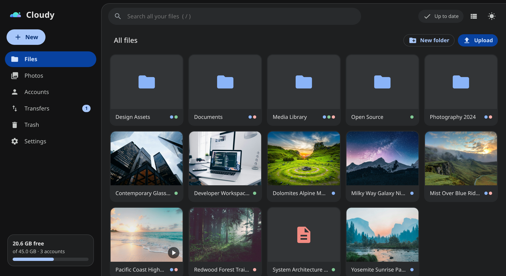
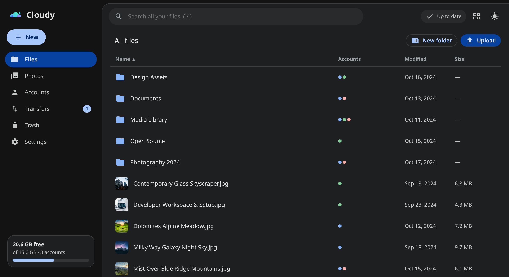
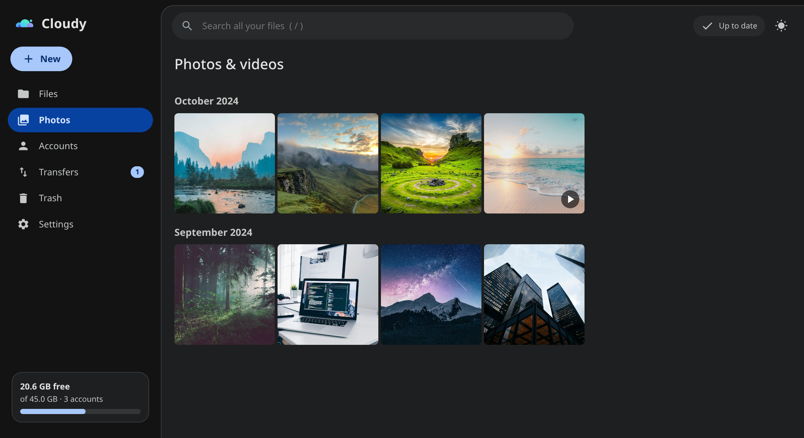
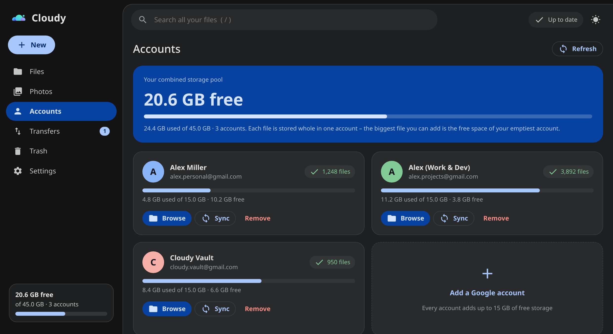
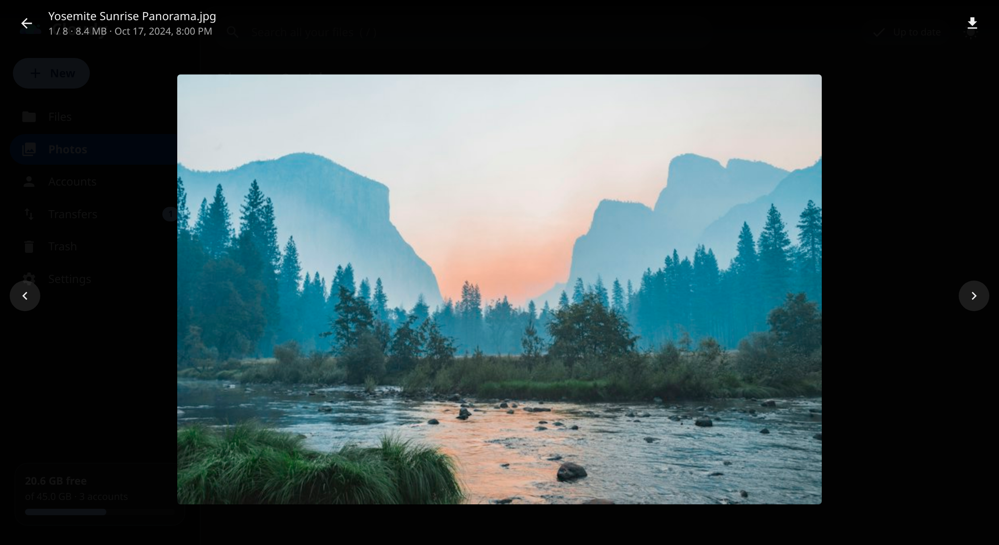
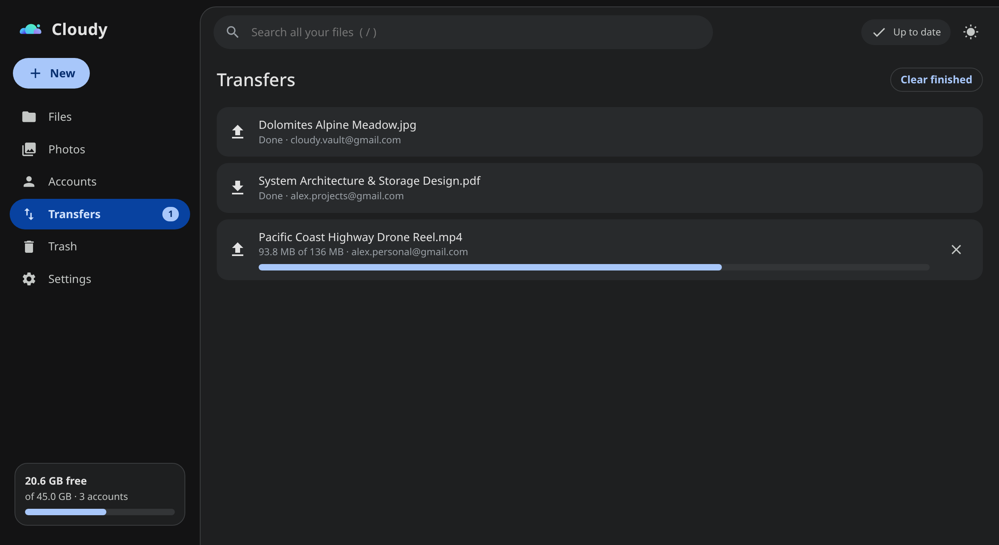

<div align="center">

# Cloudy

**Pool the free 15 GB allowance from multiple Google accounts into one unified, infinite drive.**

<p>
  <a href="https://www.rust-lang.org"></a>
  <a href="https://kernel.org"></a>
  <a href="https://tauri.app"></a>
  <a href="SETUP.md"></a>
  <a href="LICENSE"></a>
</p>

</div>

---

<pre style="white-space: pre; overflow-x: auto;">
  you@gmail.com    ──┐
  spare1@gmail.com ──┼──►  Cloudy Pool Engine  ──►  One Combined Drive (15 GB × N)
  spare2@gmail.com ──┘
</pre>

Cloudy pools the free **15 GB** from as many Google accounts as you like into a single unified drive. Browse, stream, upload, and organize everything from a native zero-latency desktop app, or mount it straight to your Linux filesystem via FUSE.

- **No file splitting or re-encoding**: Every file remains whole in its Google Drive account.
- **Smart upload balancing**: Automatically picks the account with the most free headroom.
- **Instant offline index**: Local SQLite database cache with background delta change feeds.
- **Direct & private**: Talks strictly to Google via your personal OAuth client; refresh tokens live in your system keyring.

---

<div align="center">



</div>

## Screenshots

| 🗃️ Merged Files (List View) | 🖼️ Timeline Photos & Videos |
| :---: | :---: |
|  |  |
| **Combined Storage Pool (Hero Breakdown)** | **Full-Screen Media Lightbox** |
|  |  |

### Active Transfers & Background Tasks



---

## Features

### 🗂️ Unified Virtual Drive
- **Same-named folder pooling**: Folders with matching names across distinct accounts are dynamically merged into one browsable directory.
- **Account provenance dots**: Colored badges highlight exactly which account(s) store each item.
- **Zero proprietary lock-in**: Files are never fragmented or encrypted with proprietary schemes; your raw files remain directly accessible on drive.google.com.

### 🧠 Intelligent Placement Engine
- **Headroom-aware uploads**: New files automatically go to the account with the most free space.
- **Configurable policies**: Choose between *Most Free Space*, *Round-Robin*, or *Pinned Account* placement.
- **Mirrored directory creation**: Uploading into a pooled folder automatically creates the matching parent path in the selected account.

### ⚡ Blazing Local Cache & Live Sync
- **Local SQLite index (`metadata.db`)**: App opens instantly offline without waiting for Google API calls.
- **Real-time change streaming**: Automatically picks up changes made from web or mobile via Google Drive's change feed.

### 📸 Photos & Media Streaming
- **Chronological gallery**: Photos and videos organized automatically by month.
- **In-process media server**: Fast thumbnail pipeline and byte-range seeking for hardware-accelerated video/audio streaming.
- **Full-screen lightbox**: Keyboard-driven viewer with prefetching for instant next/previous navigation.

### 🔒 Bank-Grade Local Security
- **OS keyring integration**: Refresh tokens and OAuth client secrets are safeguarded in your system keyring (KWallet / Secret Service).
- **Hardened file fallback**: Unprivileged fallback to `0600` permission-locked local storage when no desktop keyring is available.

### 🐧 Native Linux FUSE Mounting
- Mount the entire unified pool as a normal folder at `~/CloudDrive`.
- Transparently inspect both merged files under `pool/` and raw per-account contents under `accounts/<email>/`.

---

## Installation

### Requirements
- **Linux**
- **Rust stable (1.80+)**

#### Arch Linux:
```bash
sudo pacman -S --needed base-devel pkg-config fuse3 webkit2gtk-4.1 libsecret dbus
```

#### Debian / Ubuntu:
```bash
sudo apt update
sudo apt install -y libwebkit2gtk-4.1-dev libgtk-3-dev libfuse3-dev libdbus-1-dev libssl-dev pkg-config
```

#### Fedora:
```bash
sudo dnf install -y webkit2gtk4.1-devel gtk3-devel fuse3-devel libsecret-devel dbus-devel openssl-devel
```

### Build & Run

```bash
# Clone the repository
git clone https://github.com/ARYAN007H/cloudy.git
cd cloudy

# Build optimized release binaries
cargo build --release

# Launch Desktop GUI
./target/release/clouddrive-gui

# (Optional) Mount FUSE filesystem
./target/release/clouddrive-fuse
```

---

## First Run

Cloudy features an interactive built-in onboarding wizard:
1. Launch `./target/release/clouddrive-gui`.
2. Follow the 5-minute setup wizard to create your free Google Cloud OAuth credentials.
3. Link your primary and secondary accounts.

> [!TIP]
> See [SETUP.md](SETUP.md) for a step-by-step walkthrough and instructions on switching your Google Cloud app from *Testing* to *In Production* to avoid 7-day token expirations.

---

## FUSE Filesystem

Access your pooled drive directly from your terminal, file manager, or scripts:

```bash
# Default mount at ~/CloudDrive
./target/release/clouddrive-fuse

# Custom mount point with verbose foreground logging
./target/release/clouddrive-fuse --mount-point /mnt/gdrive --foreground --log-level debug

# Unmount cleanly
fusermount3 -u ~/CloudDrive
```

The mounted hierarchy provides two views:
- `pool/`: The merged, unified view of all linked accounts.
- `accounts/<email>/`: The isolated filesystem contents of each specific account.

---

## Architecture & Storage

Cloudy is built with a clean three-tier architecture:

<pre style="white-space: pre; overflow-x: auto;">
┌────────────────────────────────────────────────────────┐
│             Presentation: Tauri v2 + Vanilla JS        │
│    (Zero framework bloat, fast load, GTK WebKit engine)│
└───────────────────────────┬────────────────────────────┘
                            │ IPC / Commands
┌───────────────────────────▼────────────────────────────┐
│                  clouddrive-core                       │
│  ┌───────────────────────┐   ┌──────────────────────┐  │
│  │ Virtual Tree Engine   │   │ Upload / Sync Router │  │
│  └───────────┬───────────┘   └──────────┬───────────┘  │
│              │                          │              │
│  ┌───────────▼───────────┐   ┌──────────▼───────────┐  │
│  │ SQLite Metadata Cache │   │ Drive API Client     │  │
│  └───────────────────────┘   └──────────────────────┘  │
└───────────────────────────┬────────────────────────────┘
                            │ FUSE Interface
┌───────────────────────────▼────────────────────────────┐
│           clouddrive-fuse (POSIX Filesystem)           │
└────────────────────────────────────────────────────────┘
</pre>

### File Locations

| Component | Path | Description |
|:---|:---|:---|
| **Configuration** | `~/.config/clouddrive/config.toml` | Upload policies, sync intervals, mount points |
| **Account Registry**| `~/.config/clouddrive/accounts.json` | Non-sensitive list of linked emails |
| **Credentials** | System Keyring | Encrypted tokens via SecretService/KWallet (fallback: `0600` file) |
| **Metadata DB** | `~/.local/share/clouddrive/metadata.db`| Fast SQLite virtual tree index |
| **Logs** | `~/.local/share/clouddrive/logs/` | Daily rolling application logs |
| **Media Cache** | `~/.cache/clouddrive/` | Content slices & thumbnail LRU cache |

> [!NOTE]
> Override any location using the environment variables `CLOUDDRIVE_CONFIG_DIR`, `CLOUDDRIVE_DATA_DIR`, or `CLOUDDRIVE_CACHE_DIR`. Set `CLOUDY_LOG_STDERR=1` for terminal logging and `CLOUDDRIVE_NO_KEYRING=1` to force file storage.

---

## Important Considerations

- **Unified Quota Calculation**: Google's 15 GB quota is shared across Google Drive, Gmail, and Google Photos. Free space reflects total headroom across the whole account.
- **Maximum Single File Size**: The largest single file you can add is bounded by the free capacity of your emptiest account (files are stored whole, not sliced).
- **Inter-Account File Moves**: Moving files across accounts requires re-uploading (and temporarily doubling usage); Cloudy safely notifies you before cross-account copies.
- **Shared With Me**: Files shared with you count against someone else's quota and are not pooled.

---

## Troubleshooting

| Symptom | Cause & Solution |
|:---|:---|
| **403: access_denied** during sign-in | Your Google Cloud OAuth screen is in *Testing* mode. Add your email under **Test users**, or publish the app to Production. |
| **Sign-in needed after ~7 days** | OAuth apps in *Testing* have 7-day token lifespans. Set the project status to **In production** in Google Cloud Console ([see SETUP.md](SETUP.md)). |
| **redirect_uri_mismatch** / **invalid_client** | Ensure the OAuth client credential type is configured strictly as **Desktop app**. |
| **Drive API has not been used...** | Enable the **Google Drive API** in your Google Cloud project library. |
| **Browser doesn't open on sign-in** | Click the **Copy** button in the authorization dialog and paste the URL into your browser. |
| **Thumbnails missing on fresh uploads** | Google's background thumbnail service hasn't indexed the file yet; it populates automatically shortly after. |

---

## Development & Testing

```bash
# Run core unit and integration tests (includes mock Drive server tests)
cargo test -p clouddrive-core

# Run media server streaming tests
cargo test -p clouddrive-gui

# Run frontend smoke tests in JSDOM
cd gui/frontend-tests && npm test
```

The core end-to-end test suite (`core/tests/e2e.rs`) runs against an in-process mock Google OAuth + Drive server to validate pagination, conflict merging, token refresh, and upload resumption.

---

## License

This project is licensed under the [MIT License](LICENSE).
